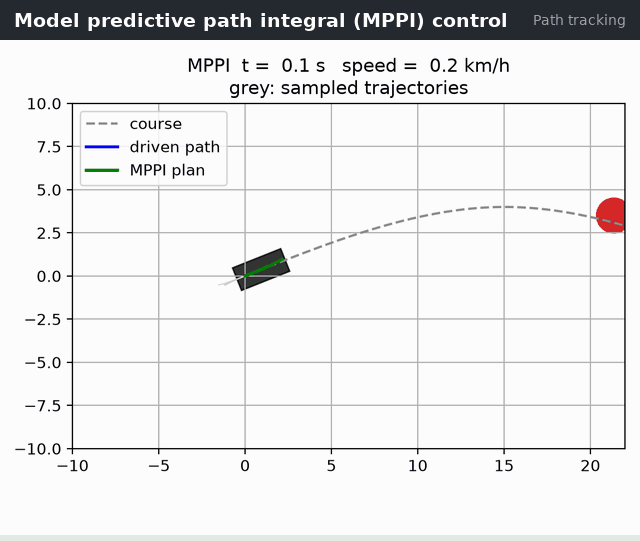
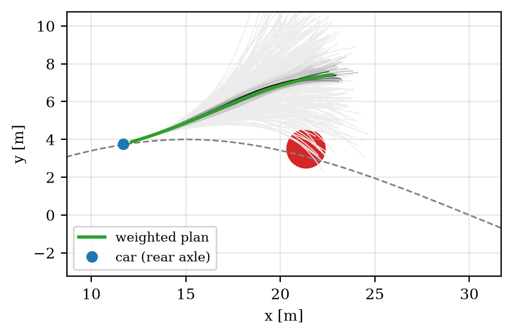

# MPPI Control for Car-Like Robots

[](https://github.com/robofan45/mppi-control/actions/workflows/ci.yml)

[](LICENSE)
[](docs/report.pdf)

Model Predictive Path Integral (MPPI) control that drives a car along a course and around obstacles by simulating 300 random control sequences every step and averaging them by cost. Vectorised NumPy, about 2.8 ms per control step, and evaluated over 20 random seeds.

<p align="center">
  
</p>

## Results

| Measure | Result |
|---|---|
| Runs that finish the course (20 seeds) | 20 of 20 |
| Time to finish: mean, worst | 16.3 s, 16.5 s |
| Closest approach to an obstacle, worst seed | 0.79 m |
| Samples that share the weight (median effective sample size) | 114 of 300 |
| Original control-cost weight and raw speed (ablation) | 16 of 20 finish, 2.5 of 300 samples |
| Runtime per control step (300 samples, 25-step horizon) | 2.8 ms |

Every number above is measured by [`scripts/make_figures.py`](scripts/make_figures.py), which also writes [`docs/results.json`](docs/results.json) and the figures of the report.

## How it works

Every control step, MPPI perturbs its current plan with $K=300$ random noise sequences, simulates a kinematic bicycle model with each one, scores the simulated trajectories, and moves the plan towards the cheap ones:

```math
w_k=\frac{\exp\big(-(S_k-\rho)/\lambda\big)}{\sum_j \exp\big(-(S_j-\rho)/\lambda\big)},\qquad
\bar u_t \leftarrow \bar u_t+\sum_k w_k\,\varepsilon_t^k ,\qquad \rho=\min_k S_k
```

Three design decisions matter more than any tuning constant, and the report explains each:

1. **Sample the steering *rate*, keep the angle in the state.** Sampling the angle directly made the applied steering jump by about 6° per step.
2. **Reward speed *along the course*, not raw speed.** With raw speed, circling beside an obstacle at full speed is cheaper than driving around it.
3. **Weight the control cost by $\gamma=\lambda/4$, not $\lambda$.** With $\gamma=\lambda$, only about 2.5 of the 300 samples share the weight, so every update copies one sample's noise. With $\gamma=5$, 114 do (Williams et al., *IEEE Transactions on Robotics*, 2018).

A study of all four combinations of decisions 2 and 3 shows that the circling failure, which stops 4 of 20 runs, needs both defects at once.

<p align="center">
  <br>
  <em>One control step: the 300 sampled trajectories (grey, darker for larger weight) and the updated plan (green).</em>
</p>

## Quick start

```bash
git clone https://github.com/robofan45/mppi-control.git
cd mppi-control
python -m pip install -e .
python -m mppi_control          # runs the animated demo
```

Requires Python 3.11 or newer; the only dependencies are NumPy, SciPy and Matplotlib.

## Tests and reproducibility

```bash
python -m pip install -r requirements-dev.txt   # pinned versions, as in CI
pytest                                          # 11 tests
ruff check . && mypy src                        # lint and type checks
python scripts/make_figures.py                  # regenerate docs/figures and docs/results.json
```

CI runs the tests, Ruff and mypy on Linux, macOS and Windows with Python 3.13 and 3.14.

## Report

**Model Predictive Path Integral Control for Car-Like Robots: Implementation, Cost Design and Robustness Evaluation** — an IEEE-style technical report (10 pages) covering the problem, the method, the implementation, the experiments and their limitations, with a full bibliography.

- [`docs/report.pdf`](docs/report.pdf) — read it on GitHub
- [`docs/report.docx`](docs/report.docx) — Word source, with native equations

## Repository layout

```text
mppi-control/
├── src/mppi_control/         the algorithm and the animated demo
├── tests/                    pytest suite
├── scripts/make_figures.py   figures and numbers of the report
├── docs/                     report (PDF and Word), figures, results.json
├── assets/demo.gif           the animation above
└── pyproject.toml            package metadata
```

## Citation

If you use this code, please cite it. GitHub's **Cite this repository** button reads [`CITATION.cff`](CITATION.cff); in BibTeX:

```bibtex
@software{trivedi2026mppi,
  author = {Trivedi, Mahim},
  title  = {MPPI Control for Car-Like Robots},
  year   = {2026},
  url    = {https://github.com/robofan45/mppi-control}
}
```

## Related projects

This project is one of seven standalone algorithm projects from the [Python Robotics Projects](https://github.com/robofan45/Python-Robotics-Projects) collection:

- [iLQR Trajectory Optimization](https://github.com/robofan45/ilqr-trajectory-optimization)
- [Control Barrier Function Safety Filter](https://github.com/robofan45/cbf-safety-filter)
- [Augmented Monte Carlo Localization](https://github.com/robofan45/monte-carlo-localization)
- [Interacting Multiple Model (IMM) Filter](https://github.com/robofan45/imm-filter)
- [Multi-Object Tracking](https://github.com/robofan45/multi-object-tracking)
- [ORCA: Optimal Reciprocal Collision Avoidance](https://github.com/robofan45/orca-collision-avoidance)

## License

[MIT](LICENSE) © 2026 Mahim Trivedi. The project grew out of [PythonRobotics](https://github.com/AtsushiSakai/PythonRobotics) by Atsushi Sakai and contributors, also MIT-licensed.
